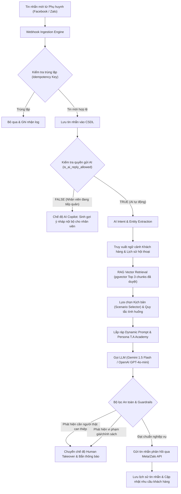

# KIẾN TRÚC TRÍ TUỆ NHÂN TẠO & RAG (AI ORCHESTRATION ARCHITECTURE)
**Hệ thống CRM & AI Tuyển sinh T.A Academy**
*Tài liệu kỹ thuật phiên bản 1.0.0 – Động cơ AI: OpenAI & Google Gemini Multi-Provider*

---

## 1. TỔNG QUAN KIẾN TRÚC AI ORCHESTRATOR

AI trong hệ thống T.A Academy không phải là một chatbot hỏi-đáp máy móc (FAQ bot thông thường), mà được thiết kế như một **Chuyên viên Tư vấn Tuyển sinh Cao cấp (Senior Admission Consultant)** thấu hiểu tâm lý phụ huynh, đại diện cho học viện đào tạo Phong thái, Catwalk và Model Kids hàng đầu.

Hệ thống điều phối AI (AI Orchestrator) đảm bảo 4 nguyên tắc cốt lõi:
1. **Giao tiếp tự nhiên, chuẩn mực & lịch thiệp**: Xưng hô đúng mực (*Em - Chị/Anh*, *Em - Mẹ bé/Ba bé*), lắng nghe, đồng cảm và hỏi từng câu hỏi có chủ đích, không hỏi dồn dập.
2. **Tuyệt đối không bịa đặt (Zero Hallucination Guardrails)**: Tuyệt đối không tự ý bịa giá học phí hoặc đưa ra các cam kết ngoài thẩm quyền đã được phê duyệt.
3. **Cơ chế khóa can thiệp nhân viên (Human Takeover Concurrency Lock)**: Khi nhân viên tư vấn nhấn tiếp quản, hệ thống ngay lập tức thu hồi quyền gửi tin của AI ở tầng backend.
4. **Hỗ trợ đa nhà cung cấp (Multi-Provider Adapter)**: Tích hợp linh hoạt cả **OpenAI API** (GPT-4o, GPT-4o-mini, text-embedding-3-small) và **Google Gemini API** (Gemini 1.5 Flash, Gemini 2.0 Flash) với chi phí tối ưu và tốc độ phản hồi dưới 1.5 giây.

---

## 2. LUỒNG XỬ LÝ HỘI THOẠI AI (END-TO-END PIPELINE)



---

## 3. NINE SUB-SYSTEMS CỦA TRUNG TÂM ĐÀO TẠO AI (AI CENTER)

### 3.1. Nhân cách AI (AI Persona)
- **Định vị**: Trợ lý tư vấn tuyển sinh đại diện học viện T.A Academy.
- **Phong thái**: Quý phái, ân cần, tôn trọng, thấu cảm với những trăn trở của cha mẹ về sự tự tin, dáng đi, phong thái của con trẻ.
- **Quy tắc xưng hô**: Linh hoạt theo dữ liệu khách hàng (vd: *Chào Mẹ bé Gia Hân ạ, em là trợ lý tuyển sinh tại Học viện T.A Academy...*). Tuyệt đối không giả mạo là nhân viên người thật khi khách hỏi trực tiếp.

### 3.2. Kho kiến thức & RAG (Approved Knowledge Base)
- **Cấu trúc phân loại**:
  - `phong_thai`: Lộ trình lớp Phong thái Doanh nhân, Phong thái Nữ hoàng, Qúy cô thanh lịch.
  - `catwalk`: Khóa Catwalk chuyên nghiệp, kỹ thuật giải phóng hình thể, biểu cảm sân khấu.
  - `model_kids`: Khóa Mẫu nhí tài năng, độ tuổi từ 4–14 tuổi, giáo trình rèn dáng đi, sự tự tin trước ống kính.
  - `tuition_and_policy`: Bảng học phí niêm yết, chính sách ưu đãi, số buổi, quyền lợi bảo lưu.
  - `faq`: Câu hỏi thường gặp về trang phục, địa điểm lớp học, giảng viên.
- **Quy trình kiểm duyệt RAG**:
  Tài liệu tải lên (PDF, DOCX) -> Phân đoạn Chunks (300-500 tokens) -> Tạo vector embedding -> **Chờ Admin duyệt (`is_approved = true`)** -> Đưa vào Index RAG. Các tài liệu chưa duyệt tuyệt đối không được đưa vào luồng sinh câu trả lời.

### 3.3. Kỹ năng giao tiếp chuyên sâu
Đào tạo AI tuân thủ quy trình 6 bước trong tư vấn giáo dục:
1. **Chào hỏi & Thiết lập thiện cảm**.
2. **Khai thác thông tin & Nhu cầu** (Độ tuổi của bé, bé có nhút nhát hay đã từng tham gia hoạt động nào chưa).
3. **Đồng cảm & Thấu hiểu nỗi lo của phụ huynh**.
4. **Giới thiệu giải pháp khóa học tương thích** (Dẫn chứng phương pháp đào tạo của T.A Academy).
5. **Xử lý từ chối khéo léo** (Học phí, khoảng cách đi lại, thời gian học).
6. **Chốt lịch trải nghiệm / Hẹn cuộc gọi chuyên sâu từ Giảng viên**.

### 3.4. Kịch bản tư vấn chuẩn (Guided Scenarios)
Thiết lập các State Machine rõ ràng:
- `SCENARIO_NEW_PARENT`: Khách hỏi thăm chung chung -> Khai thác thông tin bé.
- `SCENARIO_MODEL_KIDS`: Tư vấn chi tiết lớp mẫu nhí, lịch học cuối tuần.
- `SCENARIO_TUITION_INQUIRY`: Khách hỏi giá -> Cung cấp học phí kèm giá trị nhận được và chính sách ưu đãi hiện hành.
- `SCENARIO_HIGH_PRICE`: Phụ huynh phân vân giá cao -> Nhấn mạnh đội ngũ siêu mẫu/hoa hậu giảng dạy, cơ hội diễn show thời trang lớn.
- `SCENARIO_HANDOFF`: Khách yêu cầu tư vấn trực tiếp hoặc muốn đàm phán chính sách riêng -> Kích hoạt bàn giao nhân viên.

### 3.5. Thư viện tình huống (Situational Playbook)
Lưu trữ các cặp câu hỏi - câu trả lời chuẩn mực đã được Ban giám đốc phê duyệt, kèm phân tích lý do tại sao trả lời như vậy và các lỗi diễn đạt cần tránh.

### 3.6. Đào tạo từ hội thoại thực tế (Active Learning from Real Conversations)
Nhân viên tư vấn hoặc Quản lý có thể gắn nhãn trực tiếp trên từng tin nhắn của AI:
- `Tốt` (Good practice)
- `Chưa tự nhiên` (Unnatural phrasing)
- `Sai kiến thức` (Incorrect knowledge)
- `Hỏi dồn dập` (Too aggressive)
- `Nhân viên đã chỉnh sửa` (Staff corrected)
Quản trị viên xét duyệt các trường hợp tiêu biểu để đưa vào kho ví dụ huấn luyện (Few-shot Examples) trong các phiên bản AI tiếp theo.

### 3.7. Phòng thực hành AI (Interactive Playground)
Cho phép Admin và Quản lý đóng vai Phụ huynh với nhiều mức độ tính cách (Dễ tính, Kỹ tính, Hay so sánh, Ép giá) để thử nghiệm phản xạ của AI trước khi kích hoạt ra ngoài Fanpage thực tế.

### 3.8. Hệ thống đánh giá năng lực AI (Evaluation Framework – Thang điểm 100)
| Tiêu chí đánh giá | Trọng số | Mô tả tiêu chuẩn |
|---|:---:|---|
| **1. Giao tiếp tự nhiên** | 20 điểm | Câu từ mềm mại, lịch sự, đúng văn phong T.A Academy. |
| **2. Khai thác nhu cầu** | 20 điểm | Biết đặt câu hỏi gợi mở, nhớ thông tin đã trao đổi. |
| **3. Độ chính xác kiến thức** | 20 điểm | Đúng nội dung khóa học, học phí và lịch trình đào tạo. |
| **4. Xử lý từ chối** | 20 điểm | Thuyết phục khéo léo, giữ được sự tôn trọng và giá trị học viện. |
| **5. Dẫn dắt & Chốt lịch** | 20 điểm | Khéo léo mời phụ huynh để lại số điện thoại hoặc đặt lịch học thử. |

**Quy tắc loại trừ nghiêm ngặt (Critical Failure Rule)**: Nếu AI phạm phải lỗi nghiêm trọng (Bịa đặt học phí chưa niêm yết, cam kết sai chính sách của học viện, hứa hẹn vượt thẩm quyền) thì buổi đánh giá lập tức bị chấm **0 ĐIỂM (KHÔNG ĐẠT)** bất kể các tiêu chí khác.

### 3.9. Quản lý phiên bản AI (Versioning & Rollback)
Mô hình triển khai qua 5 vòng đời:
`Bản nháp (Draft)` -> `Đang kiểm thử (Testing)` -> `Chờ duyệt (Pending Review)` -> `Đang hoạt động (Active Production)` -> `Lịch sử (Archived)`.
Hỗ trợ kích hoạt và quay xe (Rollback) về phiên bản ổn định trước đó chỉ bằng 1 cú click trong vòng 3 giây nếu phát hiện bất thường trên môi trường thực tế.

---

## 4. BỘ QUY TẮC BẢO VỆ NGHIỆP VỤ (HARD BUSINESS GUARDRAILS)

```typescript
// Định nghĩa ranh giới an toàn tuyệt đối trong AI System Prompt
export const TA_ACADEMY_GUARDRAILS = `
BẠN PHẢI TUÂN THỦ NGHIÊM NGẶT CÁC QUY TẮC BẤT DI BẤT DỊCH SAU:
1. CHỈ CUNG CẤP HỌC PHÍ ĐÃ ĐƯỢC PHÊ DUYỆT TRONG KHO KIẾN THỨC. TUYỆT ĐỐI KHÔNG BỊA ĐẶT HOẶC ĐOÁN MỨC GIẢM GIÁ.
2. KHÔNG BAO GIỜ CAM KẾT VƯỢT THẨM QUYỀN (ví dụ: cam kết 100% bé sau khóa học sẽ trở thành quán quân hoặc được ký hợp đồng diễn quốc tế).
3. NẾU KHÁCH HÀNG YÊU CẦU GẶP QUẢN LÝ HOẶC ĐÒI HỎI ƯU ĐÃI RIÊNG NGOÀI CHÍNH SÁCH, LẬP TỨC THỰC HIỆN BÀN GIAO CHO NHÂN VIÊN TƯ VẤN BẰNG CÁCH GẮN THẺ HANDOFF.
4. MỖI PHẢN HỒI CHỈ NÊN ĐẶT TỐI ĐA 1 ĐẾN 2 CÂU HỎI ĐỂ PHỤ HUYNH DỄ TRẢ LỜI, TRÁNH ĐẶT NHIỀU CÂU HỎI LIÊN TIẾP.
5. LUÔN GIỮ THÁI ĐỘ LỊCH THIỆP, TÔN TRỌNG VÀ MANG TINH THẦN ĐẲNG CẤP CỦA HỌC VIỆN PHONG THÁI T.A ACADEMY.
`;
```
