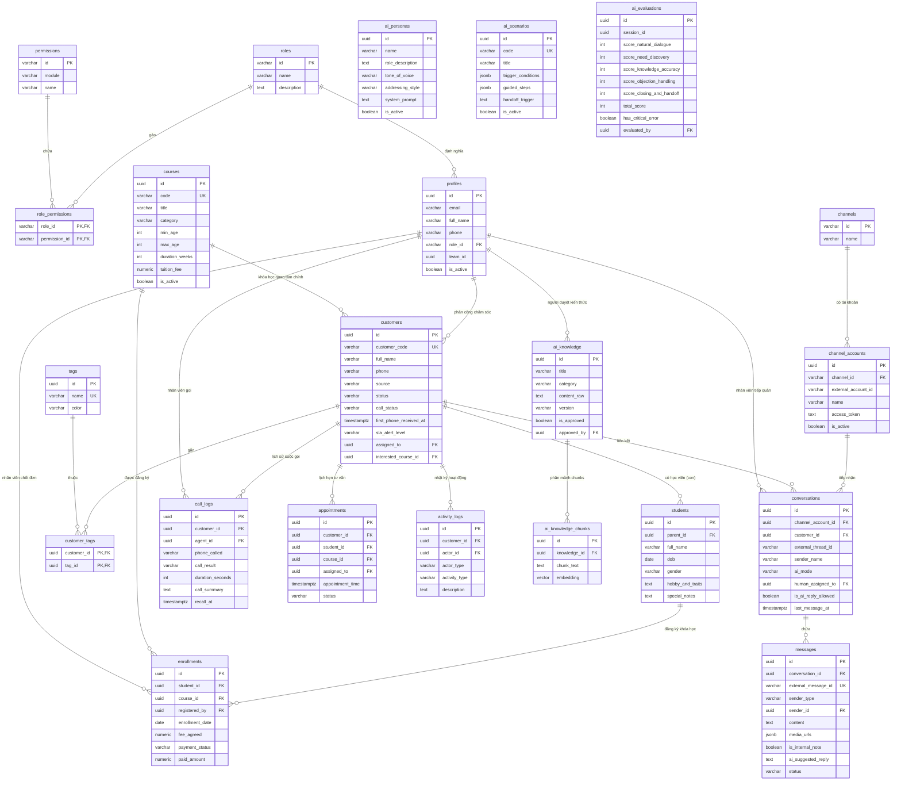

# SƠ ĐỒ QUAN HỆ THỰC THỂ (DATABASE ERD)
**Hệ thống CRM & AI Tuyển sinh T.A Academy**
*Tài liệu kỹ thuật phiên bản 1.0.0 – Chuẩn Mermaid Entity Relationship Diagram*

---

## 1. BIỂU ĐỒ QUAN HỆ THỰC THỂ (MERMAID ERD)



---

## 2. NGUYÊN TẮC QUAN HỆ CỐT LÕI

### 2.1. Quan hệ Khách hàng – Học viên (1 Phụ huynh có Nhiều con)
- Trong mô hình tuyển sinh của T.A Academy (đặc biệt khóa **Model Kids** và **Phong thái nhí**), người liên hệ và thanh toán là **Phụ huynh (Bố/Mẹ)**, nhưng người học là các **Học viên (Bé)**.
- Một phụ huynh có thể đăng ký cho 2–3 con học cùng lúc hoặc học nhiều khóa khác nhau (**Model Kids**, **Catwalk**, **Thuyết trình**).
- Do đó, bảng `customers` đại diện cho Phụ huynh và bảng `students` đại diện cho các bé, liên kết qua khóa ngoại `students.parent_id -> customers.id` (`ON DELETE CASCADE`).

### 2.2. Kiểm soát chặt chẽ Cuộc gọi và Danh sách Khách chưa gọi
- Một khách hàng xuất hiện trong danh sách **Khách chưa gọi** nếu và chỉ nếu:
  - Có số điện thoại (`customers.phone IS NOT NULL`).
  - Chưa tồn tại bản ghi cuộc gọi hợp lệ nào trong bảng `call_logs` được xác nhận bởi nhân viên (`NOT EXISTS (SELECT 1 FROM call_logs WHERE customer_id = customers.id)`).
- Việc bấm số điện thoại, mở xem tin nhắn hoặc xem hồ sơ **không làm thay đổi** trạng thái khách chưa gọi. Chỉ khi nhân viên gửi form xác nhận cuộc gọi (kết quả, thời lượng, ghi chú tóm tắt) và ghi vào `call_logs`, trigger database mới cập nhật `customers.call_status` và loại khách ra khỏi hàng đợi ưu tiên.

### 2.3. Khóa hội thoại và Phân quyền Điều khiển AI (Concurrency Lock)
- Bảng `conversations` có 2 trường quan trọng:
  - `ai_mode`: `ai_auto` (AI tự động trả lời), `human_takeover` (Nhân viên tiếp quản hoàn toàn), `ai_copilot` (AI chỉ gợi ý nháp nội bộ cho nhân viên), `closed` (Đóng hội thoại).
  - `is_ai_reply_allowed`: Cờ boolean kiểm tra ở cấp backend database.
- Khi nhân viên click **Tiếp quản hội thoại**, backend thực thi cập nhật:
  ```sql
  UPDATE conversations 
  SET ai_mode = 'human_takeover', 
      is_ai_reply_allowed = false, 
      human_assigned_to = auth.uid(), 
      takeover_at = now() 
  WHERE id = $conversation_id;
  ```
- Mọi background worker hoặc API AI đang sinh phản hồi khi phát hiện `is_ai_reply_allowed = false` sẽ ngay lập tức hủy gửi tin ra kênh Fanpage/Zalo.
