# LỘ TRÌNH TRIỂN KHAI DỰ ÁN (IMPLEMENTATION ROADMAP)
**Hệ thống CRM & AI Tuyển sinh T.A Academy**
*Kế hoạch phát triển chi tiết qua 9 giai đoạn tuần tự – Không làm tắt, có nghiệm thu từng bước*

---

## TỔNG QUAN 9 GIAI ĐOẠN

```mermaid
flowchart LR
    G1["G1: Nền tảng & Auth"] --> G2["G2: Dashboard & SLA"]
    G2 --> G3["G3: Hộp thư Đa kênh"]
    G3 --> G4["G4: Khách hàng - Học viên"]
    G4 --> G5["G5: Trung tâm AI"]
    G5 --> G6["G6: Workflows"]
    G6 --> G7["G7: Báo cáo"]
    G7 --> G8["G8: Cài đặt"]
    G8 --> G9["G9: Kiểm thử & Triển khai"]
```

---

## GIAI ĐOẠN 1: KIẾN TRÚC & NỀN TẢNG HỆ THỐNG
**Mục tiêu**: Xây dựng bộ khung kỹ thuật vững chắc, xác thực người dùng, hệ thống phân quyền RBAC và Design System chuẩn T.A Academy.
- [ ] Khởi tạo dự án Next.js 15 (App Router), TypeScript, Tailwind CSS v4, Lucide Icons.
- [ ] Cấu hình kết nối Supabase Cloud (Auth, PostgreSQL, Storage, Realtime).
- [ ] Viết và chạy các file Database Migration ban đầu (`roles`, `permissions`, `profiles`, `system_settings`).
- [ ] Xây dựng Supabase Auth Client/Server Helpers & Next.js Middleware bảo vệ tuyến đường theo RBAC.
- [ ] Xây dựng Master Layout CRM:
  - Sidebar bên trái màu Đỏ rượu vang (`#8B1D2C`), logo T.A Academy, menu động theo quyền, badge đếm tin chưa đọc.
  - Topbar: Thanh tìm kiếm toàn hệ thống (`⌘ K`), chuông thông báo, trạng thái kết nối AI/Meta, menu hồ sơ tài khoản.
- [ ] **Nghiệm thu Giai đoạn 1**: Đăng nhập/Đăng xuất ổn định, phân quyền chuyển hướng trang đúng vai trò, giao diện responsive mượt mà trên Desktop/Tablet/Mobile.

---

## GIAI ĐOẠN 2: DASHBOARD TỔNG QUAN & HÀNG ĐỢI KHÁCH CHƯA GỌI
**Mục tiêu**: Hoàn thiện màn hình điều hành trung tâm với chức năng ưu tiên số 1: Quản lý cuộc gọi khách hàng.
- [ ] Xây dựng 6 thẻ thống kê chỉ số kết nối trực tiếp database (Tổng khách, Khách mới, Khách chưa gọi, Đang tư vấn, Cần chăm sóc, Đã đăng ký).
- [ ] Xây dựng **Khu vực Khách chưa gọi (Priority Queue)**:
  - Hiển thị danh sách khách có số điện thoại nhưng chưa có cuộc gọi xác nhận.
  - Phân loại cảnh báo SLA: Vàng (>15 phút chưa gọi), Đỏ (>60 phút chưa gọi).
  - Thao tác nhanh: Gọi điện, sao chép số, mở hồ sơ, chuyển nhân viên phụ trách.
- [ ] Modal Ghi nhận kết quả cuộc gọi (Call Log Modal): Bắt buộc nhập kết quả, thời lượng và tóm tắt cuộc trao đổi để đưa khách ra khỏi hàng đợi.
- [ ] Widget Công việc hôm nay (Khách cần gọi lại, khách hẹn học thử, khách AI vừa bàn giao).
- [ ] Widget Nhật ký hoạt động Realtime.
- [ ] **Nghiệm thu Giai đoạn 2**: Không tự ý ghi nhận gọi sai, cảnh báo màu chính xác theo mốc thời gian, dữ liệu realtime khi có lead mới.

---

## GIAI ĐOẠN 3: HỘP THƯ TƯ VẤN ĐA KÊNH & ĐIỀU KHIỂN AI
**Mục tiêu**: Xây dựng khu vực làm việc chính của nhân viên chat với khách Facebook và Zalo.
- [ ] Thiết kế giao diện 3 cột chuẩn chuyên nghiệp:
  - Cột 1: Danh sách hội thoại (Bộ lọc Facebook/Zalo, Chưa đọc, AI đang chat, Cần hỗ trợ...).
  - Cột 2: Cửa sổ chat (Lịch sử tin nhắn, gửi text/ảnh, trạng thái gửi, nút gợi ý AI).
  - Cột 3: Hồ sơ vắn tắt khách hàng & học viên (Cho phép sửa trực tiếp khi đang chat).
- [ ] Bộ điều khiển 5 chế độ AI & Nhân viên (`ai_auto`, `human_takeover`, `ai_copilot`, `return_to_ai`, `closed`).
- [ ] Cơ chế khóa can thiệp ở Backend: Khi nhân viên tiếp quản, AI lập tức dừng tự động gửi.
- [ ] Endpoint Webhook Meta Facebook Messenger (`/api/webhooks/meta`) với cơ chế xác thực Verify Token và chống trùng lặp sự kiện.
- [ ] Tích hợp Supabase Realtime cho tin nhắn mới.
- [ ] **Nghiệm thu Giai đoạn 3**: Nhận/gửi tin nhắn 2 chiều ổn định, khóa AI tức thì khi nhân viên can thiệp, không bị lặp tin.

---

## GIAI ĐOẠN 4: QUẢN LÝ KHÁCH HÀNG & HỌC VIÊN
**Mục tiêu**: Quản trị dữ liệu tuyển sinh chuyên sâu với mô hình 1 Phụ huynh – Nhiều Học viên.
- [ ] Bảng danh sách khách hàng có bộ lọc nâng cao (Khóa học, Nguồn, Trạng thái, Nhân viên, Ngày tiếp nhận).
- [ ] Giao diện Hồ sơ chi tiết chia 6 khu vực:
  - Khu A: Thông tin phụ huynh (Họ tên, SĐT, Email, Khu vực).
  - Khu B: Danh sách học viên (Con) – Thêm/Sửa thông tin các bé.
  - Khu C: Nhu cầu đào tạo, khóa học quan tâm, mục tiêu rèn luyện.
  - Khu D: Trạng thái tuyển sinh (10 trạng thái từ Khách mới đến Đã đăng ký).
  - Khu E: Toàn bộ nhật ký chăm sóc (Cuộc gọi, Tin nhắn, Ghi chú, Lịch hẹn).
  - Khu F: Lịch sử đăng ký & Thông tin thanh toán học phí.
- [ ] Chức năng phân bổ lead cho nhân viên tư vấn.
- [ ] **Nghiệm thu Giai đoạn 4**: Tạo và sửa hồ sơ mượt mà, lưu trữ nhiều học viên cho 1 phụ huynh, nhật ký hoạt động tự động ghi vết.

---

## GIAI ĐOẠN 5: TRUNG TÂM ĐÀO TẠO AI (AI CENTER)
**Mục tiêu**: Xây dựng "bộ não" tư vấn tuyển sinh thông minh với 9 phân hệ.
- [ ] Phân hệ 1: Cấu hình Nhân cách AI (Persona, xưng hô, phong thái T.A Academy).
- [ ] Phân hệ 2: Kho kiến thức RAG (Tải tài liệu, phân đoạn chunks, sinh embeddings, phê duyệt).
- [ ] Phân hệ 3: Kỹ năng giao tiếp chuyên sâu (Quy tắc đặt câu hỏi, lắng nghe, đồng cảm).
- [ ] Phân hệ 4: Quản lý Kịch bản tư vấn chuẩn (State Machine theo khóa học).
- [ ] Phân hệ 5: Thư viện tình huống thực tế (Hỏi giá cao, bé nhút nhát...).
- [ ] Phân hệ 6: Đào tạo từ hội thoại thực tế (Gắn nhãn và duyệt mẫu huấn luyện).
- [ ] Phân hệ 7: Phòng thực hành AI (Playground mô phỏng chat thử nghiệm).
- [ ] Phân hệ 8: Đánh giá năng lực AI theo thang điểm 100 (5 tiêu chí x 20 điểm, rớt ngay nếu bịa giá).
- [ ] Phân hệ 9: Quản trị phiên bản AI (Draft -> Test -> Active -> Rollback).
- [ ] **Nghiệm thu Giai đoạn 5**: AI trả lời đúng kiến thức được duyệt, không bịa giá, biết chốt lịch và bàn giao nhân viên khi gặp tình huống phức tạp.

---

## GIAI ĐOẠN 6: QUY TRÌNH TƯ VẤN & AUTOMATION (WORKFLOWS)
**Mục tiêu**: Tự động hóa các nghiệp vụ tuyển sinh lặp đi lặp lại.
- [ ] Visual Workflow Builder (Trigger -> Condition -> Action -> Wait -> Notify).
- [ ] Cài đặt 5 workflow mặc định của học viện:
  - Tiếp nhận lead mới và phân bổ nhân viên xoay vòng.
  - Quét kiểm tra SLA khách chưa gọi (15 phút cảnh báo, 60 phút ưu tiên cao).
  - AI tiếp nhận sơ bộ ngoài giờ hành chính.
  - Bàn giao hội thoại khi phụ huynh yêu cầu gặp chuyên viên.
  - Nhắc lịch gọi lại theo cuộc hẹn đã tạo.
- [ ] Nhật ký thực thi workflow và cơ chế retry khi gặp sự cố mạng.
- [ ] **Nghiệm thu Giai đoạn 6**: Workflow chạy đúng điều kiện kích hoạt, không bị vòng lặp vô tận.

---

## GIAI ĐOẠN 7: BÁO CÁO THỐNG KÊ & PHÂN TÍCH
**Mục tiêu**: Cung cấp bức tranh toàn diện cho Ban giám đốc và Trưởng nhóm.
- [ ] Báo cáo tuyển sinh: Số lượng lead theo nguồn, theo khóa học, tỷ lệ chuyển đổi qua từng phễu.
- [ ] Báo cáo hiệu quả nhân viên: Số cuộc gọi hợp lệ, thời lượng gọi trung bình, số lịch hẹn học thử, doanh thu học phí mang về.
- [ ] Báo cáo AI: Số hội thoại xử lý tự động, tỷ lệ bàn giao, điểm số đánh giá chất lượng, chi phí token API.
- [ ] Xuất báo cáo Excel/CSV theo thẩm quyền phân quyền.
- [ ] **Nghiệm thu Giai đoạn 7**: Số liệu báo cáo khớp 100% với dữ liệu giao dịch thực tế trong CSDL.

---

## GIAI ĐOẠN 8: CÀI ĐẶT HỆ THỐNG & KẾT NỐI KÊNH
**Mục tiêu**: Màn hình quản trị cấu hình trung tâm (như ảnh mockup tham chiếu).
- [ ] Quản lý tài khoản nhân viên & Gán vai trò RBAC.
- [ ] Màn hình Cấu hình Chatbot AI Fanpage: Nhập API Key (Gemini/OpenAI), Webhook URL, Verify Token, Page Access Token, nút kiểm tra kết nối realtime.
- [ ] Màn hình Quản lý Khóa học (Tên, độ tuổi, học phí, chính sách ưu đãi - nguồn kiến thức chuẩn cho AI).
- [ ] Cấu hình mốc thời gian cảnh báo SLA và danh mục hệ thống.
- [ ] Giao diện xem Nhật ký bảo mật (Audit Logs).
- [ ] **Nghiệm thu Giai đoạn 8**: Kết nối và kiểm tra API thành công với thông báo trạng thái trực quan.

---

## GIAI ĐOẠN 9: KIỂM THỬ TỔNG THỂ, BẢO MẬT & TRIỂN KHAI
**Mục tiêu**: Kiểm thử tải, rà soát an ninh mạng và đưa hệ thống vào vận hành.
- [ ] Kiểm thử tải giả lập (Stress Test) với 500 – 2.000 khách hàng và 10 nhân viên thao tác đồng thời.
- [ ] Kiểm thử bảo mật (Penetration Test): RLS validation, ngăn chặn lộ Service Role Key, chống XSS/SQL Injection.
- [ ] Thiết lập sao lưu tự động (Automated Backup) CSDL Supabase.
- [ ] Triển khai lên Vercel Production và đấu nối domain chính thức `crm.taacademy.vn`.
- [ ] Nghiệm thu UAT với đội ngũ Tuyển sinh T.A Academy.
